# Atendimento do Professor

## Terças e quintas. Professor de horário parcial. Nesses 2 dias, podem contar comigo!

## Semana 04 - Sensores e Processamento de Valores de Entrada (Analógico e Digital) com ESP32

Conceitos de entradas digitais e analógicas e leitura de valores de sensores para sensoriamento/monitoramento automatizado usando o ESP32. Os exemplos desta aula são o **LDR** (sensor analógico de luz), o **sensor ultrassônico HC-SR04** (sensor digital de distância por tempo de eco) e o **sensor de presença PIR** (sensor digital com saída liga/desliga). A instrução também tratará de requisitos não funcionais.

---

## Impacto no seu Projeto

### Essa aula pode decidir a viabilidade de alguns sensores no seu projeto.

- Você sabe se o sensor que você está usando é suficientemente preciso para a sua aplicação?
- Você sabe se o ESP32 está arredondando valores ao transformar o sinal analógico do LDR em digital?
- Você sabe qual é o mínimo de sensibilidade do ESP32 ao capturar mudanças de valores do sensor analógico?
- Para detectar que alguém se aproximou de um equipamento, o que o seu projeto precisa: só saber **se** tem presença (PIR, liga/desliga) ou saber **a que distância** está o objeto (ultrassônico)?

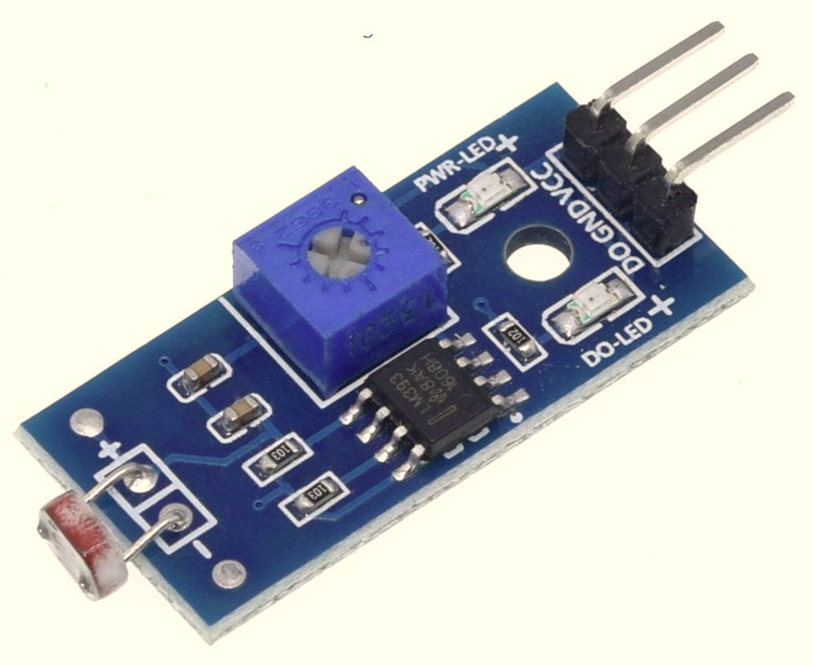
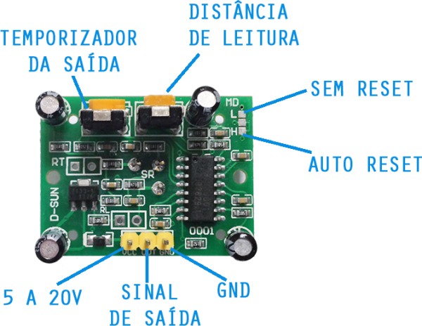
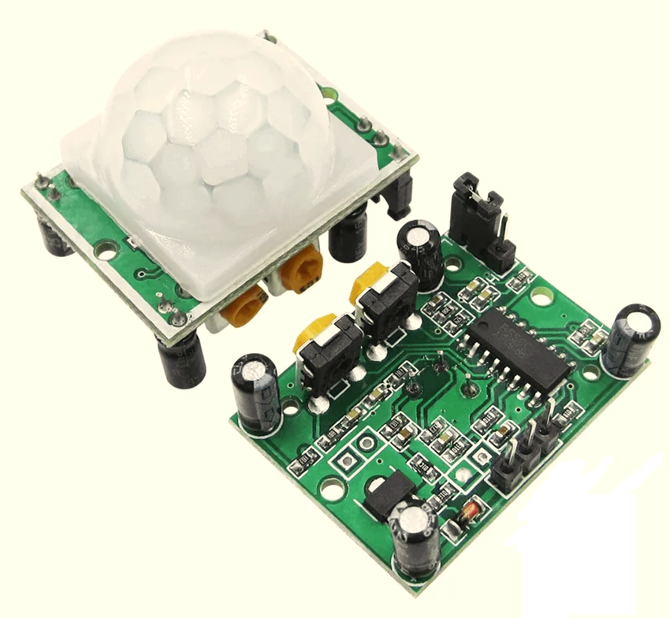
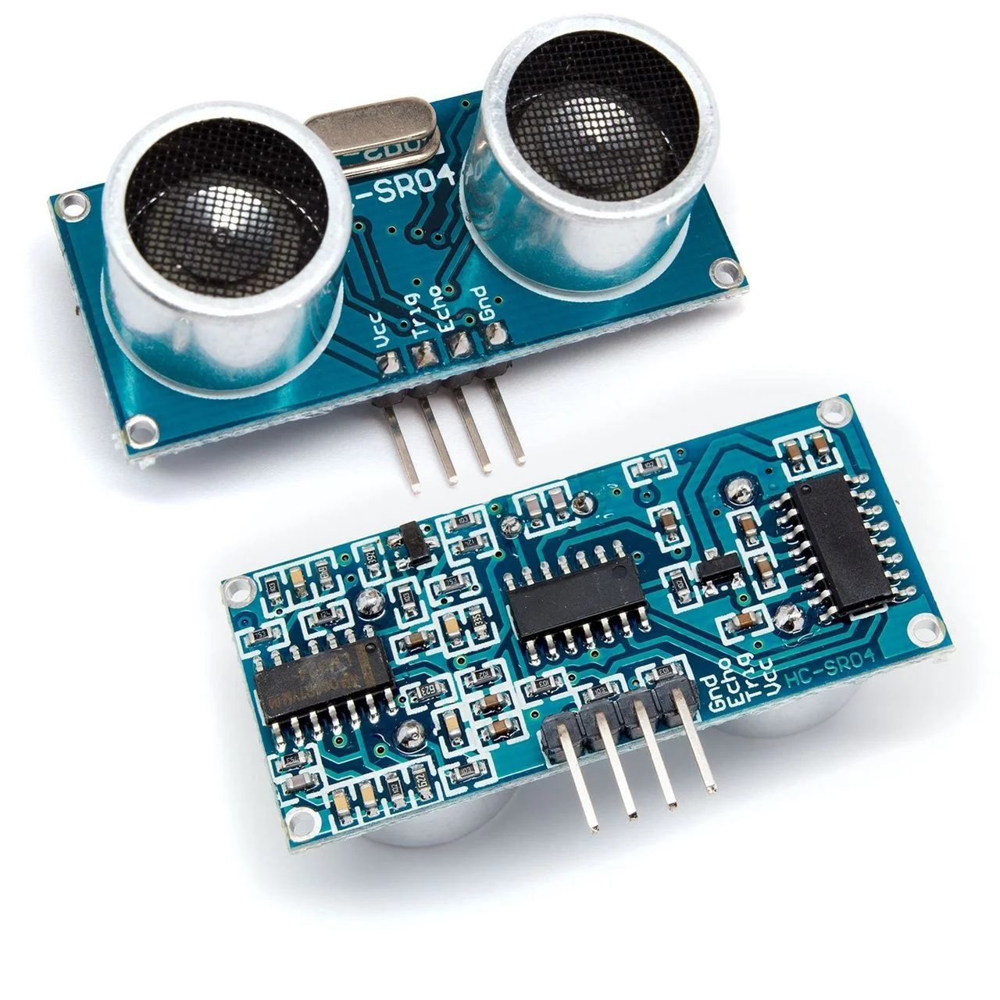


### Para responder essas perguntas, vejamos a nossa trilha de hoje:

## 1. Sensor analógico x sensor digital
   - O que muda na forma de ler cada um

## 2. Como digitalizar o sinal analógico (exemplo do LDR)
   - Definições
   - Amostragem
   - Quantização
   - Codificação

## 3. Sensores digitais
   - Ultrassônico HC-SR04 (distância por tempo de eco)
   - PIR (presença liga/desliga)

## 4. Prática com TinkerCad e Wokwi

---

## 1. Sensor analógico x sensor digital

Antes de digitalizar qualquer coisa, precisamos saber **que tipo de sinal** o sensor entrega:

| Sensor | Tipo de sinal | Como o ESP32 lê | Informação |
|---|---|---|---|
| **LDR** | Analógico (resistência varia de forma contínua com a luz) | `analogRead()` no pino ADC | Valor de 0 a 4095 (12 bits) |
| **HC-SR04** | Digital (pulso de eco cuja largura é proporcional à distância) | `pulseIn()` medindo tempo | Tempo em microssegundos → distância |
| **PIR** | Digital liga/desliga | `digitalRead()` | 1 bit: HIGH (movimento) ou LOW (parado) |

Só o LDR passa pelo conversor analógico-digital (ADC). Os outros dois já entregam um sinal digital, por isso o processo de amostragem/quantização/codificação que veremos a seguir se aplica principalmente ao **LDR**.

---

## 2. Por que Digitalizar Sinais?

Os microcontroladores e computadores possuem memórias finitas e padronizadas em bits, enquanto os seres humanos e a natureza utilizam sinais analógicos.

Como os sinais analógicos não são compatíveis diretamente com os bits, é necessário digitalizá-los para armazenamento e processamento no mundo digital. É exatamente o que acontece quando o ESP32 lê o LDR. Este processo envolve três etapas principais:

1. **Amostragem**
2. **Quantização**
3. **Codificação**

---

## Amostragem

A amostragem consiste em capturar "fotos" do sinal analógico em intervalos regulares de tempo.


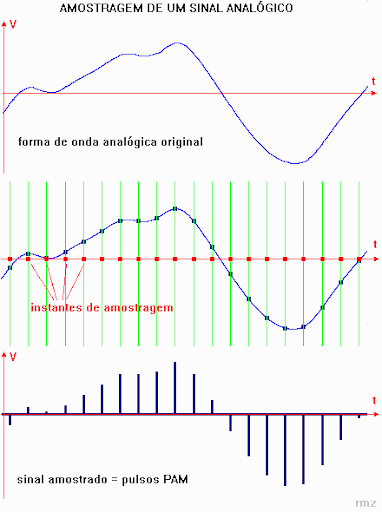


**Regra de Ouro:**
A taxa de amostragem (f<sub>A</sub>) deve ser pelo menos duas vezes maior que a frequência máxima (f<sub>MAX</sub>) do sinal analógico para garantir que o sinal possa ser recuperado sem perda de informações.

### f<sub>A</sub> >= 2.f<sub>MAX</sub>


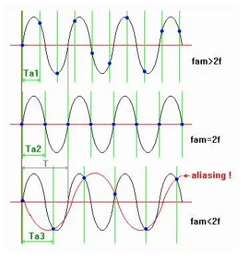


---

## Quantização

A quantização é o processo de arredondar os valores amostrados para o degrau mais próximo em uma escala discreta, seja no quadrante positivo ou negativo.

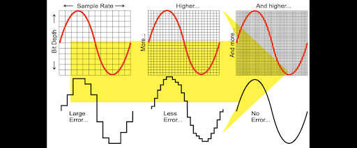

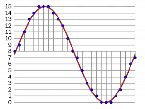


**Regra de Ouro:**
- O número de degraus = 2<sup>Nbits</sup>
- Mais bits resultam em mais degraus, menos erro de quantização, mas maior tamanho do arquivo.
- Menos bits resultam em menos degraus, mais erro por arredondamento, mas menor tamanho do arquivo.

### degraus = 2<sup>Nbits</sup>

No ESP32, o ADC é de 12 bits → 2<sup>12</sup> = **4096 degraus** (valores de 0 a 4095). No Arduino Uno, o ADC é de 10 bits → 2<sup>10</sup> = **1024 degraus** (valores de 0 a 1023). Guarde essa diferença, porque ela aparece na prática do LDR.

---

## Codificação

A codificação converte o valor quantizado em uma sequência binária para armazenamento e processamento em memória digital.

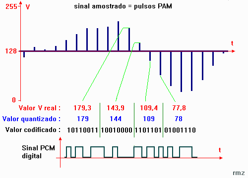


### Resumo do Processo:
- **Amostragem:** Captura de amostras (fotos) do sinal analógico para evitar aliasing.
- **Quantização:** Arredondamento das amostras para o degrau mais próximo.
- **Codificação:** Conversão dos valores quantizados para uma sequência binária.

---

## Quais pinos estão envolvidos nesse conceito?

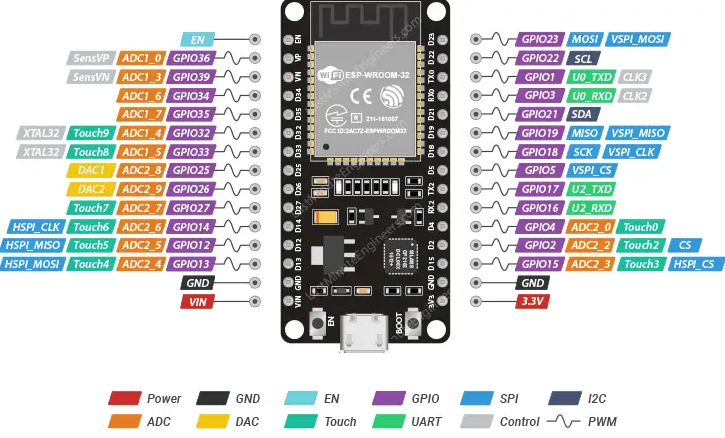


* Onde há pinos nomeados de **DAC** indicam que liberam sinal analógico em degraus, que são os pinos 25 e 26.
* Onde há pinos nomeados de **ADC** indicam que recebem sinal analógico verdadeiros e convertem para digital, que são 02 04 15 12 13 14 25 26 27 32 33 34 35 36 e 39.
* Onde há pinos com sinal de til ```~``` indicam que podem emitir sinais equivalentes ao analógico, que são sinais PWM.

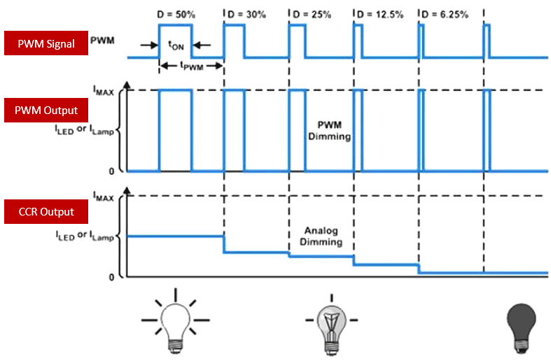


Quanto mais tempo o sinal quadrado se manter, maior o brilho da lâmpada. Quanto menor o tempo o sinal quadrado se manter, menor a tensão média no LED, logo seu brilho se diminui.

**Onde cada sensor entra:**
- **LDR** → qualquer pino **ADC** (ex.: GPIO 34, que é só entrada).
- **HC-SR04** → um pino digital de saída para o *trigger* (ex.: GPIO 5) e um digital de entrada para o *echo* (ex.: GPIO 18).
- **PIR** → um pino digital de entrada (ex.: GPIO 27).

---

## 3. Sensores digitais

### 3.1 Sensor ultrassônico HC-SR04


O HC-SR04 mede distância por **tempo de voo do som**: ele emite um pulso ultrassônico e mede quanto tempo o eco leva para voltar. Não usa o ADC, o microcontrolador apenas cronometra a largura de um pulso digital.

- Você dá um pulso de 10 µs no pino **Trig**.
- O sensor devolve, no pino **Echo**, um pulso HIGH cuja **duração** é o tempo de ida e volta do som.
- Como o som percorre ~343 m/s, cada centímetro de ida e volta leva ≈ 58 µs. Logo: `distância_cm = duração_us / 58`.

> ⚠️ **Requisito não funcional (nível de tensão):** o HC-SR04 trabalha em 5 V e seu pino Echo devolve 5 V. O ESP32 é de 3,3 V. Ligar o Echo direto no ESP32 pode danificar o pino, use um **divisor de tensão** (ex.: 1 kΩ + 2 kΩ) no Echo.

### 3.2 Sensor de presença PIR (HC-SR501)


O PIR detecta a radiação infravermelha emitida por corpos quentes em movimento (pessoas, animais). A saída é **digital liga/desliga**: fica em HIGH enquanto há movimento e volta a LOW quando para. Ou seja, carrega **1 único bit** de informação, não há o que quantizar.

- Leitura com `digitalRead()`.
- A maioria das placas HC-SR501 entrega a saída já em 3,3 V, compatível com o ESP32.
- Dois potenciômetros na placa ajustam **sensibilidade** (alcance) e **tempo** que a saída fica em HIGH após detectar.

---

## 4. Prática

### 4.1 LDR: comparando a resolução do ADC Arduino vs ESP32

Aqui vamos ver na prática a diferença de bits do ADC usando o **LDR** como entrada analógica e um **LED** como saída (o brilho acompanha a luz lida).

**a) Monte no Wokwi com ESP32**

Use o LDR num divisor de tensão (LDR + resistor de 10 kΩ) ligado ao pino A0, e o LED num pino PWM.

```cpp
const int ldrPin = A0;   // LDR no divisor de tensão (entrada analógica)
const int ledPin = 9;    // LED na saída PWM
int ref = 0, limite = 500;

int sensorValue = 0;     // valor lido do LDR
int outputValue = 0;     // valor enviado ao PWM (saída analógica)

void setup() {
  Serial.begin(9600);        // inicializa o Monitor Serial
  pinMode(ledPin, OUTPUT);
}

void loop() {
  if (millis() - ref >= limite) {
    ref = millis();
    sensorValue = analogRead(ldrPin);               // lê de 0 a 1023 (10 bits)
    outputValue = map(sensorValue, 0, 1023, 0, 255); // regra de três entre as faixas
    analogWrite(ledPin, outputValue);               // joga o resultado no LED
    Serial.print("LDR = ");
    Serial.print(sensorValue);
    Serial.print("\t LED = ");
    Serial.println(outputValue);
  }
}
```


**b) Agora abra o Wokwi e monte o mesmo circuito com o ESP32**

Ligue o LDR no GPIO 34 (ADC) e o LED no GPIO 25 (DAC/PWM).

```cpp
const int ldrPin = 34;   // LDR no ADC do ESP32 (entrada analógica)
const int ledPin = 25;   // LED no DAC/PWM do ESP32
int ref = 0, limite = 500;

int sensorValue = 0;     // valor lido do LDR
int outputValue = 0;     // valor enviado ao PWM (saída analógica)

void setup() {
  Serial.begin(9600);        // inicializa o Monitor Serial
  pinMode(ledPin, OUTPUT);
}

void loop() {
  if (millis() - ref >= limite) {
    ref = millis();
    sensorValue = analogRead(ldrPin);               // lê de 0 a 4095 (12 bits)
    outputValue = map(sensorValue, 0, 4095, 0, 255); // regra de três entre as faixas
    analogWrite(ledPin, outputValue);               // joga o resultado no LED
    Serial.print("LDR = ");
    Serial.print(sensorValue);
    Serial.print("\t LED = ");
    Serial.println(outputValue);
  }
}
```

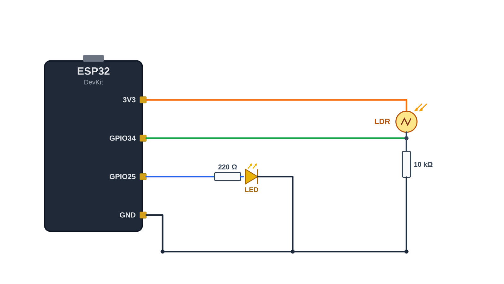

Compare os valores no Monitor Serial: o Arduino chega no máximo a 1023, o ESP32 a 4095. É a quantização em ação, mais bits, degraus mais finos.

### 4.2 HC-SR04: medindo distância (Wokwi com ESP32)

```cpp
const int trigPin = 5;
const int echoPin = 18;   // usar divisor de tensão no Echo (5V -> 3.3V)
long duracao;
float distanciaCm;

void setup() {
  Serial.begin(115200);
  pinMode(trigPin, OUTPUT);
  pinMode(echoPin, INPUT);
}

void loop() {
  // dispara o pulso de 10 us
  digitalWrite(trigPin, LOW);
  delayMicroseconds(2);
  digitalWrite(trigPin, HIGH);
  delayMicroseconds(10);
  digitalWrite(trigPin, LOW);

  // mede a largura do pulso de eco (tempo de ida e volta do som)
  duracao = pulseIn(echoPin, HIGH);

  // distancia = tempo / 58  (som ~343 m/s, ida e volta)
  distanciaCm = duracao / 58.0;

  Serial.print("Distancia = ");
  Serial.print(distanciaCm);
  Serial.println(" cm");

  delay(200);
}
```
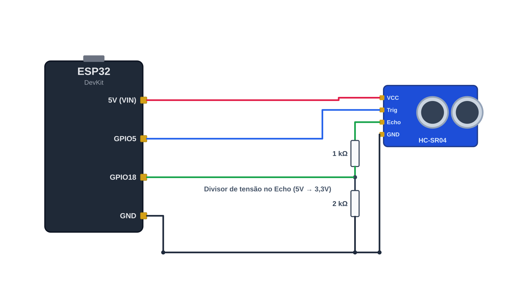


### 4.3 PIR: detectando presença (Wokwi com ESP32)

```cpp
const int pirPin = 27;   // saida digital on/off do PIR
const int ledPin = 2;    // LED indicador
int estado = 0;

void setup() {
  Serial.begin(115200);
  pinMode(pirPin, INPUT);
  pinMode(ledPin, OUTPUT);
}

void loop() {
  estado = digitalRead(pirPin);   // HIGH = movimento, LOW = parado

  if (estado == HIGH) {
    digitalWrite(ledPin, HIGH);
    Serial.println("Movimento detectado!");
  } else {
    digitalWrite(ledPin, LOW);
  }

  delay(100);
}
```

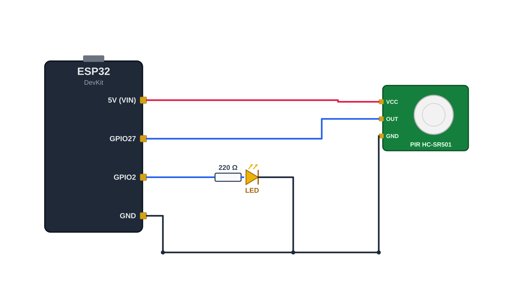

---

## Desafio

**Objetivo:** Explicar as diferenças entre sensores analógicos e digitais via uma **pair teaching**.

Cada grupo fará a sua apresentação respondendo:

1. Quantos bits de ADC e DAC o Arduino possui? E o ESP32?
2. O HC-SR04 usa o ADC do ESP32 para medir distância? Por quê?
3. Quantos bits de informação o PIR entrega? O que isso significa na prática?
4. Quais dos três sensores precisam de divisor de tensão e por quê?
5. Qual o impacto da resolução do ADC na leitura de um sensor analógico como o LDR?
6. Para detectar uma pessoa se aproximando de uma máquina, qual sensor você escolheria: PIR (presença) ou ultrassônico (distância)? Justifique pelo requisito do seu projeto.

A melhor explicação ganhará um prêmio!

Apresentação de 3 minutos. Todos os grupos apresentam.
